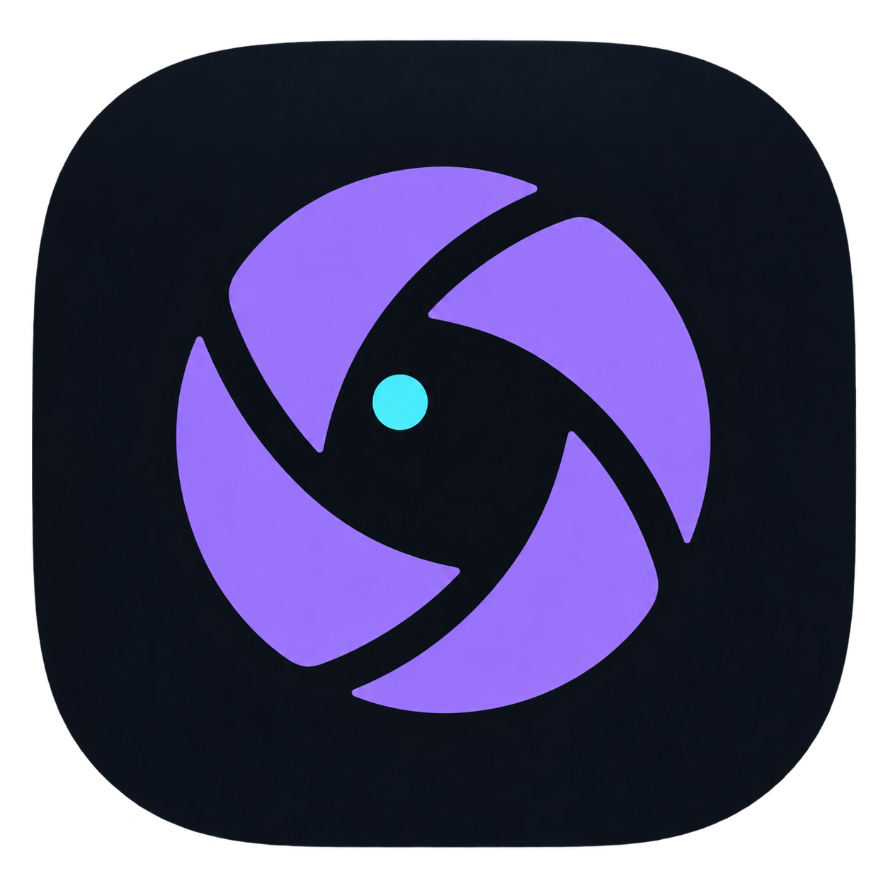

<p align="center">
  
</p>

<h1 align="center">Reverse Engineering Browser</h1>

<p align="center">
  <strong>A research build of Brave, and the Mac app that reads what it recorded.</strong>
</p>

<p align="center">
  <a href="https://github.com/sunghoojung/reverse-engineering-browser/actions/workflows/ci.yml"></a>
  <a href="https://github.com/sunghoojung/reverse-engineering-browser/releases/latest"></a>
  <a href="#install"></a>
</p>

<p align="center">
  <a href="#install">Install</a> ·
  <a href="#what-it-records">What it records</a> ·
  <a href="#build">Build</a> ·
  <a href="docs/README.md">Docs</a> ·
  <a href="SAFETY.md">Safety</a>
</p>

---

For authorized work on the fingerprints, obfuscated scripts, and small virtual
machines a web page ships.

**Brave Browser Development** is Brave with probes compiled into the browser.
While you browse, those probes record the requests, API calls, scripts, and
WebAssembly the page uses. **Origin Trace** is the Mac app that reads that
recording from a local store and lays it on one timeline, so you can start
from a request or a script and walk back to the evidence behind it.

The recording is written by the browser. Origin Trace only reads it. Services
stay on loopback. Read [SAFETY.md](SAFETY.md) before you capture anything.

## Install

Apple silicon. The two apps are about 1 GiB, plus browser profiles and
session data.

1. Download Origin Trace and Brave Browser Development from the
   [latest release](https://github.com/sunghoojung/reverse-engineering-browser/releases/latest).
2. Check both ZIPs against the `SHA256SUMS` file in that release. The pair
   record names the Brave build those probes belong to.
3. Unzip them side by side, or put Brave in `/Applications`, and open Origin Trace.

Origin Trace starts capture and an isolated Brave window. A session runs for
one hour with the implemented capture categories, bounded request content,
Canvas images, quiet mode, and Wasm dispatch. A page `debugger;` statement
is ignored. **New Live Session…** records metadata only. What that pair
includes is on the release page.

Both apps are ad-hoc signed and not notarized. Brave Browser Development is
a workstation build from pinned sources, not a Brave Software release.

> [!IMPORTANT]
> Captures can contain credentials. The raw store is not masked. A redacted
> Traffic export is a separate copy
> ([contract](protocol/traffic-capture-copy-v1.md)). Read a capture before
> you share it.

## What it records

| In Origin Trace | You get |
| --- | --- |
| **Traffic** | Each request by tab, host, and type. The default session keeps the method, full path and query, request body and response body, up to 16 MiB each, with Response and Preview tabs. Headers stay in the browser. |
| **Fingerprints** | Calls and property reads for Canvas, WebGL, Web Audio, device and layout, Permissions, Storage, WebRTC, and runtime checks. Canvas images are optional. |
| **Sources** | Hashed copies of the JavaScript and Wasm the page loaded or generated, with search and deobfuscation that keeps the original bytes. |
| **VM** | Where Wasm and JavaScript dispatched, set next to static analysis, including nested VMs. A row is the dispatch the engine performed. |
| **Notebooks** | Notes attached to that evidence, kept on disk. |

The native console runs in a document you select, separate from capture.
A coding agent can use the same loopback API through `reb-api`. Agree on
scope first ([local coding agents](docs/development/local-coding-agents.md)).

Live stepping and request replay are outside this build. The page can tell
that capture is on.

```text
native probe -> bounded renderer transport -> browser-process bridge
             -> event broker -> evidence store -> Origin Trace
```

Probes ship as overlays on pinned Brave and Chromium revisions. They stay
off until a session enables them, and a full queue records a drop. Records
are versioned in [`protocol/`](protocol/README.md). The
[technical architecture](docs/architecture/technical-architecture.md) has the
component map.

| Path | Contents |
| --- | --- |
| [`apps/`](apps/) | Origin Trace, its Rust backend, and small native tools |
| [`browser/`](browser/README.md) | Brave pins, overlays, patches, and bootstrap |
| [`include/reb/`](include/reb/), [`src/`](src/) | C++ events, queues, and transport |
| [`services/`](services/) | Event broker and artifact receiver |
| [`protocol/`](protocol/README.md) | Versioned wire and storage contracts |
| [`tools/`](tools/README.md) | Offline checks and analysis utilities |
| [`docs/`](docs/README.md) | Architecture, product notes, and build guides |

## Build

Point `make live` at a Brave Browser Development binary that includes these
probes, such as the one from the latest release:

```sh
REB_BRAVE_BINARY="/path/to/Brave Browser Development.app/Contents/MacOS/Brave Browser Development" \
make live
```

Browse in that Brave window. Evidence is under `build/sessions/live/`. Close
Brave to end the session. `REB_CAPTURE_REQUEST_CONTENT=1` keeps request paths,
queries, and bodies for that session, which is what the packaged app does by
default. `REB_CAPTURE_CANVAS_IMAGES=1` keeps `HTMLCanvasElement.toDataURL()`
output in the local store, up to 2 MiB an image.

Building Brave needs macOS, full Xcode, Node.js, pnpm, Python 3, and at
least 150 GiB free (200 to 250 GiB is safer). The first compile takes hours.

```sh
./scripts/bootstrap-brave.sh --init
./scripts/sync-browser-integration.sh
make brave-doctor
make brave-probe-check
./scripts/brave-toolchain.sh build
```

See [fast browser builds](docs/development/fast-browser-builds.md) and the
[integrated build path](docs/development/integrated-brave-build.md). The
packaged app is macOS-only. The
[Windows and Linux guide](docs/development/windows-linux-build.md) covers the
Linux development UI and an unverified WSL 2 route.

Before a pull request, run `make lint`, `make check`, `make e2e`, and
`make sanitize`. `make agent-preflight` checks the diff against `origin/main`.
macOS UI changes also need the packaged-app checks in
[CONTRIBUTING.md](CONTRIBUTING.md).

The [Origin Trace guide](apps/research-ui/README.md) covers the workspace.
The [reference](docs/product/origin-trace-reference.md) covers behavior and
limits. Release notes for each pair are on
[GitHub Releases](https://github.com/sunghoojung/reverse-engineering-browser/releases).
The [documentation index](docs/README.md) lists the rest.
Coding agents follow [AGENTS.md](AGENTS.md).
