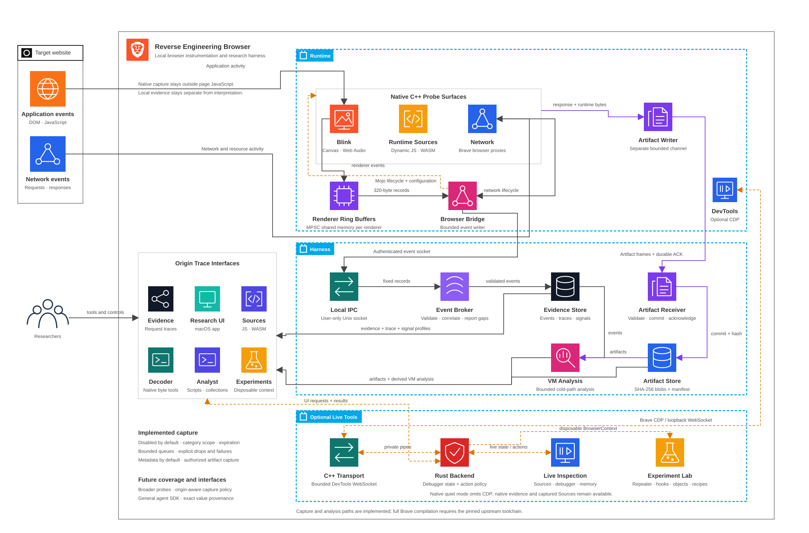

# System Architecture

This diagram describes the implemented repository paths. The broader
[technical architecture](./technical-architecture.md) describes the intended
product direction; components in that design are not all implemented. The SVG
is the editable diagram source.

## Native capture and local evidence

1. Native binding and V8 runtime probes across eight fingerprint families,
   lower-level Canvas, WebGL and Web Audio hooks, and request-initiation probes write fixed 320-byte
   records to a bounded shared-memory **multi-producer, single-consumer (MPSC)**
   queue per renderer. Render and worker threads produce events; the browser
   process is the sole consumer. Mojo carries session configuration, lifecycle,
   and coalesced wake-ups. Disabled or expired capture returns before insertion.
2. The browser-process bridge drains renderer queues and observes network
   lifecycle metadata through Brave's existing URL loader proxies. A separate
   bounded writer delivers records over an authenticated user-only Unix socket.
   Renderer probes never wait for storage or open harness sockets.
3. The event broker validates records, enforces the session ID, category mask,
   and expiration, reports sequence gaps, and writes versioned JSONL evidence.
   Optional cold-path indexes write Origin Trace edges and request signal
   profiles. Identifier relationships support observed or correlated links,
   not arbitrary JavaScript value provenance.
4. Authorized JavaScript and WASM response content, runtime-generated source,
   and explicitly enabled Canvas data URLs use a separate artifact path. Runtime
   source and Canvas output arrive through bounded Mojo submission; response
   bytes use an asynchronous browser-process tee. None puts artifact bytes into
   the renderer event queue. The artifact receiver commits SHA-256 blobs and
   manifest records before acknowledging acceptance. Failed captures become
   explicit events.
5. Origin Trace reads bounded projections of evidence and artifact stores.
   The cold-path VM analyzer reads events and artifacts and writes a separate
   derived analysis document. It never runs inside a probe, browser capture
   path, broker, or artifact receiver, and never overwrites original bytes.

The current live transports are Unix sockets. Windows named pipes are part of
the broader design, not a shipped transport. Capture policy enforces categories
and expiration; the native event envelope does not yet provide the trustworthy
origin identity needed for origin allowlisting. Authorization and capture rules
are defined in [`SAFETY.md`](../../SAFETY.md).

Implementation and contracts:
[native probes](../../browser/integration/brave/overlay/components/reverse_engineering_browser/README.md),
[event broker](../../services/event-broker/README.md),
[artifact receiver](../../services/artifact-receiver/README.md), and
[shared protocol](../../protocol/README.md).

## Application and live debugging

The normal macOS application uses Swift and WKWebView. `make app` packages and
opens the application, which starts its bundled capture services, analysis
worker, loopback Rust backend, and an isolated instrumented Brave profile.
`make live` provides the same orchestration from the repository for development
and fixture testing. `make ui` serves the browser development interface alone.
Explicit store or demo arguments retain the native stored-evidence reader path
without starting another session.

Live capture uses native Brave/V8 probes, bounded native transport, and the Rust
evidence reader. REB no longer launches a DevTools endpoint or a CDP transport.
Legacy debugger routes return a removal error and are absent from CLI/MCP
discovery. Native console and owned VM fixture controls are separate capabilities,
not fallbacks for the removed debugger. Physical Wasm observations use the
[typed native contract](../../protocol/native-wasm-dispatch-v1.md). JavaScript
dispatch at armed static interpreter-candidate sites uses the
[native JavaScript dispatch contract](../../protocol/native-js-dispatch-v1.md).

Decoder Lab uses a separate native transform helper. API Collection and Local
Analyst Workspace persist user-authored templates and scripts separately from
captured evidence. Analyst scripts run explicitly in a restricted helper with
selected evidence inputs.

The CDP experiment tools (request interception, Repeater, Object Lab, Runtime
Hook Studio, automation recipes and Memory) were removed with the debugger.
Explicit page mutation is limited to the native Console, which defaults to a
disposable profile and is distinct from observational native capture.

`REB_NATIVE_QUIET_MODE=1 make live` additionally enables the patched V8
behavior that ignores page-authored `debugger;` statements. Native capture and
Captured Sources are unchanged; Origin Trace has no debugger transport in any
mode.

See the [Origin Trace operating guide](../../apps/research-ui/README.md) and
[live-session launcher](../../scripts/run-live-session.sh) for mode-specific
behavior and limits.

## Scope and verification

The diagram separates existing paths from planned broader Blink, V8, and GPU
probe coverage, origin-aware capture authorization, a general agent SDK and
gateway, and exact field-level value provenance. A supported event category or
UI view does not imply complete native probe coverage. The local MCP adapter is
only a stdio projection of the OpenAPI document. A general agent SDK or gateway
remains out of scope.

Tracked Brave overlays and patches are implemented integration sources, not
proof that a complete custom browser has been compiled on every host. Native,
socket, fixture, and UI tests validate their respective boundaries; a full
browser build additionally requires the pinned Brave and Chromium toolchain.
See the [Brave integration guide](../../browser/integration/brave/README.md)
and [feature roadmap](../product/feature-list.md).
